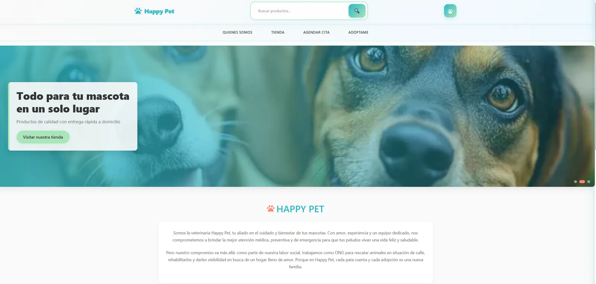
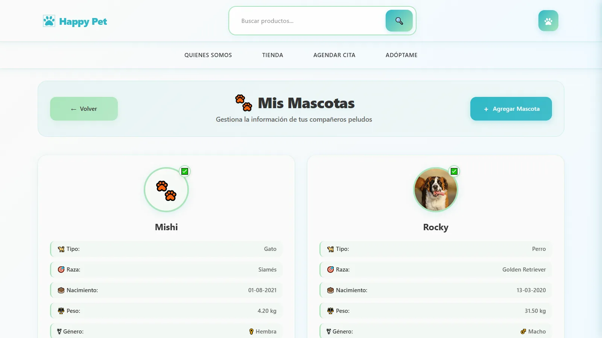
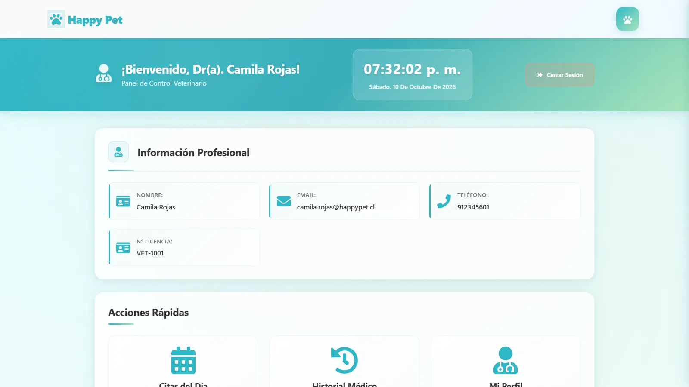

# Happy Pet · Sistema de gestión veterinaria

Proyecto de título: plataforma web y móvil para una clínica veterinaria. Tiene un portal para dueños de mascotas y un panel para veterinarios, con agenda de citas, fichas clínicas, tienda, adopciones y videoconsultas.

**Demo en vivo:** https://proyecto-titulo-wya2.vercel.app

| Cuenta de prueba | Usuario | Contraseña |
|---|---|---|
| Dueño | RUT `11111111-1` | `demo1234` |
| Veterinario | `camila.rojas@happypet.cl` | `demo1234` |

Los datos de la demo son ficticios.



| Mis mascotas (dueño) | Panel del veterinario |
|---|---|
|  |  |

## Funcionalidades

**Dueños de mascotas**
- Registro e inicio de sesión con RUT.
- Ficha de cada mascota, con foto, raza, peso y microchip, y acceso a su historial clínico.
- Agendamiento de citas por especialidad y veterinario, más la lista de citas con opción de cancelar.
- Perfil con cambio de email, teléfono y contraseña.

**Veterinarios**
- Panel con estadísticas del día.
- Citas asignadas, con filtros por estado y fecha. Se pueden cancelar o completar con notas de la atención; al completar se abre el formulario del historial clínico.
- Historial clínico: crear, editar y eliminar registros (consultas, vacunas, exámenes…) con archivos adjuntos.
- Videollamada con el dueño (Agora).

**Público**
- Tienda con catálogo, búsqueda y carrito. La compra es simulada: no hay pagos ni se guardan pedidos.
- Mascotas en adopción, páginas de especialidades y "Quiénes somos".

## Estructura del repositorio

| Carpeta | Contenido | Tecnologías |
|---|---|---|
| [`WEB/`](WEB) | Aplicación web (la de la demo) | React 18, TypeScript, Vite, React Bootstrap, Axios, Agora |
| [`BACKEND/`](BACKEND) | API REST | Node.js, Express 5, MySQL 8 (mysql2), JWT, bcrypt, Multer |
| `app-veterinaria/` | App móvil para dueños | Ionic, Angular 19, Capacitor |
| `veterinaria_2/` | Segunda versión de la app móvil | Ionic, Angular 20, Capacitor |

> Las apps móviles todavía no envían el token de sesión, así que no funcionan con la versión actual del backend.

## Arquitectura en producción

```
Navegador ──► WEB (Vercel, sitio estático) ──► BACKEND (Vercel Function, Express)
                                                  ├──► MySQL 8 en Aiven (conexión TLS)
                                                  └──► Vercel Blob (fotos y adjuntos subidos)
```

La web y la API son dos proyectos de Vercel conectados a este mismo repositorio: uno con *Root Directory* `WEB` y el otro con `BACKEND`.

## Seguridad

- Contraseñas con hash **bcrypt**. Ninguna respuesta de la API las incluye.
- Sesiones con **JWT**: el token se envía en `Authorization: Bearer <token>` y expira en 8 horas, configurable.
- **Permisos por rol y por propiedad**:
  - Un dueño solo accede a sus mascotas, citas e historial.
  - Un veterinario solo gestiona sus citas y edita los registros clínicos que él creó.
  - El dueño de una mascota o el autor de un registro se toman del token, nunca de los datos que envía el cliente.
- Los errores no exponen detalles internos de la base de datos.
- Subidas con nombre generado por el servidor, tipos permitidos (imágenes, PDF y Word) y un máximo de 4 MB.
- CORS restringido a los orígenes configurados.

## Ejecutar en local

**Requisitos:** Node.js 20 o superior y MySQL 8.

### 1. Base de datos y backend

```powershell
cd BACKEND
npm install
copy .env.example .env      # completa los datos de tu MySQL y un JWT_SECRET
npm run db:cargar           # solo verifica la conexión y muestra cuántas tablas hay
npm run db:cargar -- --confirmar   # crea las tablas y carga los datos demo (la base debe estar vacía)
npm run dev                 # API en http://localhost:3000
```

`db:cargar` aplica [`db/schema.sql`](BACKEND/db/schema.sql) y [`db/seed.sql`](BACKEND/db/seed.sql). También puedes cargarlos a mano con el cliente `mysql`.

Si tienes una base creada antes del login con bcrypt (con contraseñas en texto plano), respáldala y conviértelas con `npm run db:hashear-passwords -- --confirmar`. Sin `--confirmar` solo muestra cuántas cuentas convertiría.

### 2. Web

```powershell
cd WEB
npm install
copy .env.example .env.local    # VITE_API_URL=http://localhost:3000
npm run dev                     # http://localhost:5173
```

Otros comandos de la web: `npm run build` (compila y verifica tipos con TypeScript), `npm run lint` y `npm run preview`.

## Variables de entorno

### Backend (`BACKEND/.env` en local, *Environment Variables* en Vercel)

| Variable | Requerida | Descripción |
|---|---|---|
| `DB_HOST`, `DB_PORT`, `DB_USER`, `DB_PASSWORD`, `DB_NAME` | Sí (`DB_PORT` por defecto 3306) | Conexión a MySQL |
| `JWT_SECRET` | Sí | Clave para firmar los tokens; mínimo 32 caracteres aleatorios |
| `JWT_EXPIRES_IN` | No (por defecto `8h`) | Duración de la sesión |
| `CORS_ORIGINS` | No (por defecto `http://localhost:5173`) | URLs del frontend permitidas, separadas por coma |
| `DB_SSL_CA` | Solo con TLS (Aiven) | Contenido del certificado CA en PEM (uso en Vercel) |
| `DB_SSL_CA_FILE` | Solo con TLS (Aiven) | Ruta al certificado, relativa a `BACKEND/` (uso en local, por ejemplo `ca.pem`) |
| `APP_TIMEZONE` | No (por defecto `America/Santiago`) | Zona horaria de la clínica para interpretar las fechas de la base |
| `PORT` | No (por defecto 3000) | Puerto en local |

Al conectar un almacenamiento **Vercel Blob** al proyecto, Vercel agrega sus variables automáticamente. Sin Blob, en local las subidas se guardan en `BACKEND/public/uploads`; en Vercel la API responde 503 a las subidas.

### Web

| Variable | Descripción |
|---|---|
| `VITE_API_URL` | URL del backend, sin barra final. Se incorpora al compilar, así que hay que volver a desplegar si cambia |

## Endpoints principales

Todas las rutas comienzan con `/api`. "Token" significa que requiere `Authorization: Bearer <token>`.

| Recurso | Acceso |
|---|---|
| `POST /duenos/login`, `POST /veterinarios/login` | Público; responden un token |
| `POST /duenos` (registro) | Público |
| `GET /especies`, `/razas`, `/tipos-consulta`, `/productos`, `/categorias`, `/adopciones`, `/veterinarios` | Público |
| `/duenos/:rut` | Token: el propio dueño (los veterinarios pueden leerlo) |
| `/mascotas` | Token: el dueño de la mascota; los veterinarios pueden ver fichas |
| `/citas` | Token: el dueño agenda o cancela las suyas; el veterinario asignado las gestiona |
| `/historial-clinico` | Token: lectura para el dueño y los veterinarios; edición solo para el veterinario autor |
| `POST/PUT/DELETE /adopciones` | Token de veterinario |

El detalle de cada ruta está en [`BACKEND/src/routes`](BACKEND/src/routes).

## Limitaciones conocidas

- Las apps móviles Ionic no están adaptadas al login con JWT.
- Las videollamadas usan un App ID de Agora sin servidor de tokens, lo que solo sirve para pruebas.
- No hay límite de intentos de inicio de sesión.
- Las fotos y adjuntos en Vercel Blob son públicos para quien conozca su URL (los nombres son aleatorios).

## Autor

**Héctor Sanhueza**: [GitHub](https://github.com/JS-Ranker) · [LinkedIn](https://www.linkedin.com/in/hectorsanhueza/)
